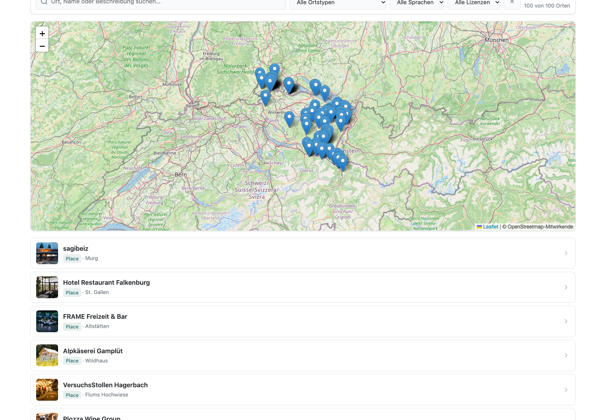
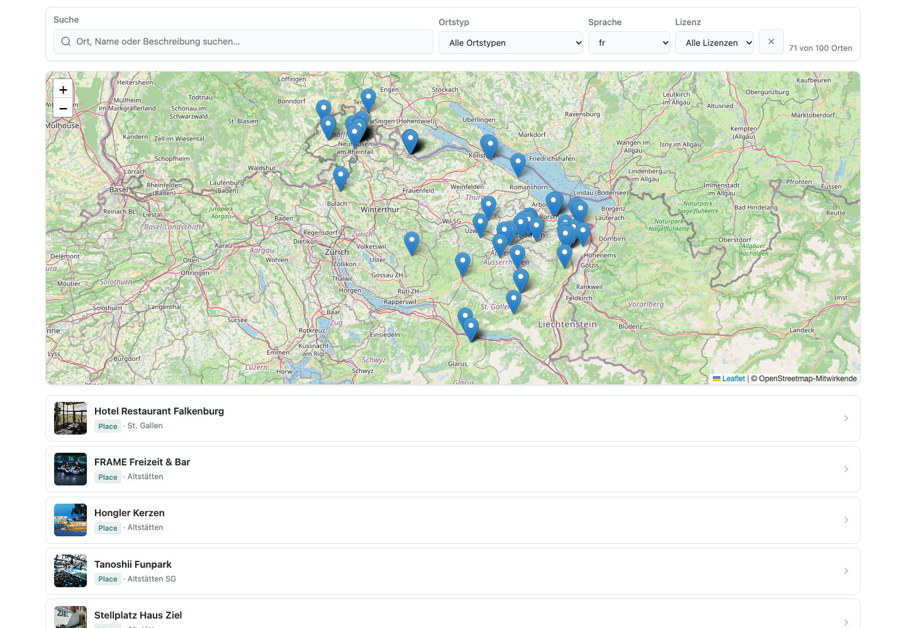
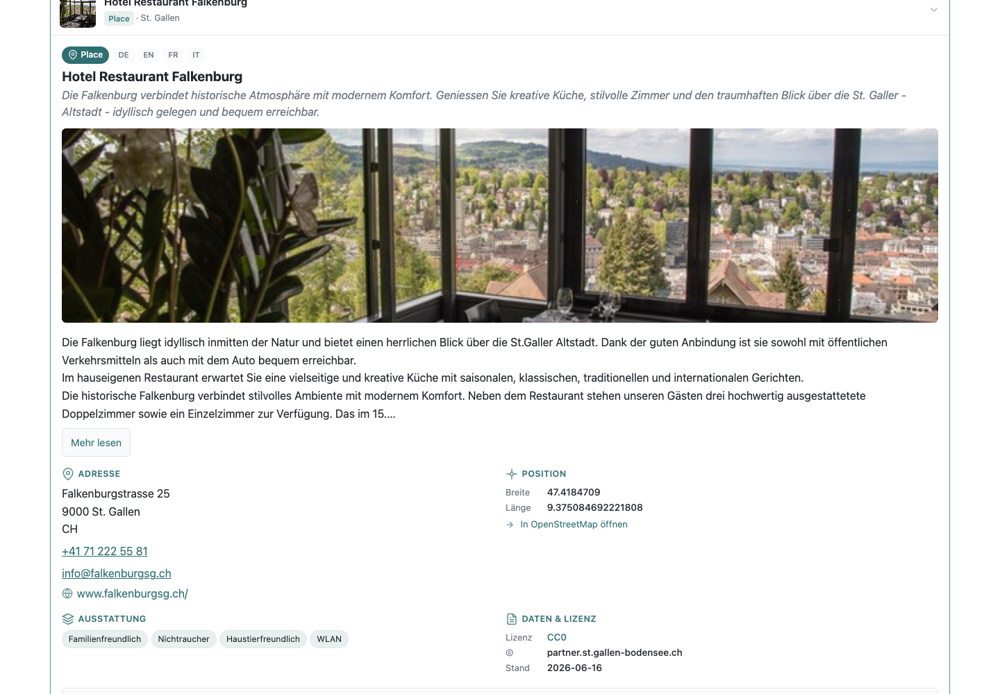
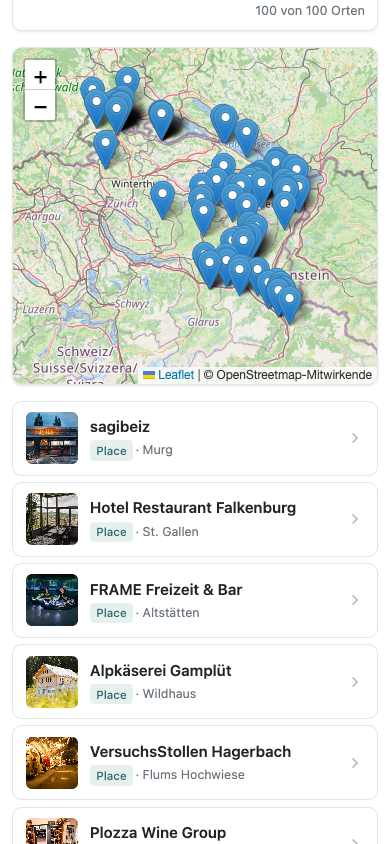
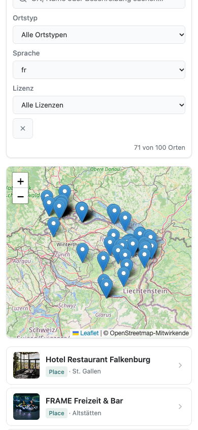
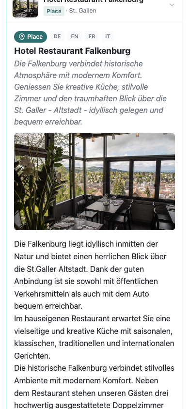

Die App **Ausflugsziele (ODTA – Tourist Attraction)** macht die touristischen Orte der Ostschweiz entdeckbar:
Sehenswürdigkeiten, historische Gebäude, Naturattraktionen wie der Rheinfall, Berge, Gewässer und Touren
werden auf einer interaktiven Karte, in einer filterbaren Liste und in einer Detailansicht präsentiert.
Jeder Ort lässt sich zusätzlich als strukturierter JSON-LD-Datensatz anzeigen, kopieren oder herunterladen.

Die App ist für die Verwendung im [Open Data App Store](https://open-data-app-store.de/) gemacht
und entspricht der [Open Data App](https://open-data-apps.github.io/open-data-app-docs/open-data-app-spezifikation/).

Mehr zu Open Data Apps unter https://github.com/open-data-apps

---

## Funktionen
Die App ist eine Single Page Application (Webapp) mit:

- Logo-Anzeige
- Menü
- Seiten für Impressum, Datenschutz, Beschreibung, Kontakt, Hauptinhalt
- Inhaltsbereich
- Fußzeile

Die Konfiguration wird vom ODAS geladen. Die App zeigt folgende Inhalte:

- **KPI-Kacheln**: Gesamte Orte, Ortstypen, Lizenzen, Sprachen – mit konfigurierbaren, über Info-Schalter aufklappbaren Kontexttexten
- **Volltextsuche und Filter**: Suche nach Name, Beschreibung, Adresse; Filter nach Typ, Sprache und Lizenz
- **Listenansicht**: Clientseitiges Paging, Inline-Detailansicht pro Ort
- **Interaktive Karte**: Leaflet.js mit OpenStreetMap-Kacheln und POI-Markern; ein Klick öffnet den Ort auf der passenden Listenseite
- **Detailansicht**: Bildergalerie, sicher formatierte Beschreibung, gut lesbare Adresse und Kontaktangaben mit Telefon-/E-Mail-Links, GPS, verständliche Ausstattungsmerkmale und Lizenzinformationen
- **Lange Beschreibungen**: Ab mehr als 600 sichtbaren Unicode-Zeichen eine Vorschau mit „Mehr lesen“/„Weniger anzeigen“; kurze Texte vollständig
- **JSON-LD-Export**: Anzeigen, Kopieren und Herunterladen pro POI, auch bei mehreren gleichzeitig geöffneten Orten; Sprachwerte und Quelländerungsdatum bleiben erhalten
- **Zusatzinformationen**: Methodik und verwandte Links starten separat eingeklappt; Kennzahlen und kurzer Datenstand bleiben sichtbar

---

## Für wen ist diese App?
Diese App richtet sich an Gäste und Einheimische, die touristische Orte der Ostschweiz erkunden möchten,
sowie an Kommunen und Tourismusverantwortliche, die ODTA-konforme Daten visualisieren wollen.
Es sind keine besonderen Datenkenntnisse nötig – die Bedienung erfolgt über Karte, Liste und Filter.

---

## Datenformat
Die App lädt schema.org-konformes JSON direkt im Browser:

- **Place.json**: Array von schema.org-Objekten mit `@type`, mehrsprachigem `name`/`description`, `address` (PostalAddress), `geo` (GeoCoordinates), `image` (ImageObject-Array), `license`, `dateModified`, `identifier` (UUID), `amenityFeature`, `openingHours` und weiteren Feldern
- Die Quelle erlaubt CORS (`Access-Control-Allow-Origin: *`) – ein direkter `fetch` im Browser ist möglich
- Kein API-Key erforderlich

---

## Kompatible Datensätze
Die App ist kompatibel mit CONTENTDESK-basierten OpenData-Portalen, die schema.org-konforme Places-Daten bereitstellen:

| Datensatz | Quelle | Lizenz |
| --- | --- | --- |
| Places (POIs / Tourist Attractions) | OpenData Portal Ostschweiz Tourismus | CC0 / CC BY / CC BY-SA |
| OpenStreetMap-Kacheln | OpenStreetMap contributors | ODbL |

Die Datenendpunkt-URL kann in der Instanz-Konfiguration auf andere CONTENTDESK-basierte Portale umgestellt werden.

---

### Systemvoraussetzungen
- Docker / Docker Compose
- Make

Die Entwicklung wurde getestet unter Windows und Ubuntu.

### Starten
```bash
make build up
```

Die App wird gestartet und steht auf Port 8089 zur Verfügung: http://localhost:8089

Weil die App mit localhost gestartet wird, wird die Konfiguration lokal geladen.

### Lokale Entwicklung mit VS Code Live Server

Alternativ kann die App mit VS Code Live Server aus der Projektwurzel gestartet werden. Öffne dann `http://127.0.0.1:<live-server-port>/app/`; Live Server nutzt standardmäßig Port `5500`.

Empfohlene ODAS-Einstellungen:

```json
{
  "liveServer.settings.host": "127.0.0.1",
  "liveServer.settings.root": "/",
  "liveServer.settings.file": "app/index.html"
}
```

`liveServer.settings.file` ist optional. `liveServer.settings.root` sollte für ODAS-Apps normalerweise `/` bleiben, damit `app/` und `odas-config/` gleichzeitig erreichbar sind. Die App erkennt Localhost (127.0.0.1/localhost) automatisch und lädt dann `odas-config/config.json`; kein Edit an `app/app-base.js` nötig.

### Aufbau der App
Der Inhaltsbereich wird in `app/app.js` erstellt. Dort sind Datenladen, CORS-Proxy-Fallback, Filter, Paginierung, Leaflet-Karte, Detailansicht, JSON-LD-Export und Schale-4-Komponenten implementiert. Template-eigene Dateien (`app/app-base.js`, `app/app-base.css`, `app/index.html`) werden nicht verändert. Leaflet wird dynamisch nachgeladen.

#### Screenshots

**Startseite mit Karte und Trefferliste**



**Gefilterte Trefferliste**



**Detailansicht eines POI**



**Mobile Ansicht**





### Wichtige Dateien
| Datei | Beschreibung |
| --- | --- |
| `app/app.js` | Hauptlogik: Datenladen, Filter, Karte, Detailansicht, JSON-LD-Export, Schale 4 |
| `app-package.json` | App-Metadaten und Instanz-Konfigurationsfelder für den ODAS |
| `assets/schema.json` | Frictionless Data Schema – allgemeingültiges Datenmodell |
| `assets/odas-app-icon.svg` | ODAS-konformes App-Icon |
| `odas-config/config.json` | Lokale Konfiguration für die Entwicklung |

### Rich-Text-Format: Markdown vs. HTML

Die Rich-Text-Felder (`beschreibung`, `kontakt`, `impressum`, `datenschutz`, `datenquelleHinweis`,
`verwandteLinks`, `weiterfuehrendeLinks`, `kpiKontext1` bis `kpiKontext4`) sind in `app-package.json` bewusst als **Markdown**
verfasst (`##`-Überschriften, `-`-Listen, `[Text](URL)`-Links). ODAS wandelt `format.typ:
"markdown"`-Felder vor der Auslieferung an die App selbst in HTML um (siehe
`open-data-app-spezifikation.md`, Abschnitt „Multiline und Rich Text").

Die lokale `odas-config/config.json` enthält dieselben Inhalte dagegen als **HTML** — sie
simuliert damit die von ODAS bereits konvertierte Config, weil die lokale `app/app-base.js`
selbst keinen Markdown-Parser mitbringt und den Wert unverändert per `innerHTML` ausgibt. Beim
Ändern eines Rich-Text-Felds müssen beide Dateien inhaltlich synchron gehalten werden, aber im
jeweils passenden Format.

Externe POI-Beschreibungen werden getrennt davon behandelt: Die App erzeugt aus einem inerten HTML-Template nur erlaubte Absatz-, Listen-, Hervorhebungs- und Linkelemente neu. Styles, Event-Attribute und eingebettete aktive Inhalte werden nicht übernommen; Beschreibungslinks müssen absolute HTTP(S)-URLs sein. Die Textvorschau verändert weder Quelldaten noch Export.

Der JSON-LD-Export verwendet für mehrsprachige Texte explizite `@value`-/`@language`-Werte. Das Quelländerungsdatum heißt `schema:dateModified`; es wird nicht als Veröffentlichungsdatum des Exports ausgegeben. Die geprüfte Maschinenlesbarkeit dieser Felder ersetzt keine vollständige Zertifizierung gegen eine ODTA Domain Specification.

---

## Konfiguration (Instanz)
Folgende Parameter werden bei der App-Instanzierung im ODAS konfiguriert:

| Parameter | Beschreibung | Pflicht |
| --- | --- | --- |
| `apiurls` | URLs zu Datenressourcen. Eintrag `ausflugsziele`: URL zu den Places-Daten (schema.org-/ODTA-konformes JSON, siehe „Andere Datensätze verwenden" unten) | ja (Eintrag `ausflugsziele`) |
| `urlDaten` | URL zur Katalog-Seite des Datensatzes im ODP | ja |
| `standardSprache` | Anzeigesprache für mehrsprachige Felder (de/en/fr/it) | ja |
| `sprache` | Sprache der App (`de`) | ja |
| `lizenz` | Lizenz der App | ja |
| `titel` | Anzeigetitel der App | ja |
| `seitentitel` | Browser-Tab-Titel | ja |
| `kpiKontext1` | KPI-Kontexttext: Gesamte Orte | nein |
| `kpiKontext2` | KPI-Kontexttext: Ortstypen | nein |
| `kpiKontext3` | KPI-Kontexttext: Lizenzen | nein |
| `kpiKontext4` | KPI-Kontexttext: Sprachen | nein |
| `datenquelleHinweis` | Aufklappbarer Methodik-Kasten (Markdown) | nein |
| `datenStand` | Zusätzlicher Text zum Datenstand | nein |
| `verwandteLinks` | Aufklappbare verwandte Links (Markdown), Fallback | nein |
| `weiterfuehrendeLinks` | Aufklappbare weiterführende Links (Markdown), hat Vorrang vor `verwandteLinks` | nein |

### Andere Datensätze verwenden

Die App ist nicht an die Ostschweiz-Quelle gebunden. Jede Quelle, die per `apiurls.ausflugsziele` eingebunden
wird, muss folgende Voraussetzungen erfüllen:

- HTTPS-Endpunkt, der ein **JSON-Array auf oberster Ebene** liefert (kein CKAN-Wrapper, kein
  `result.records`)
- Objekte im schema.org-/ODTA-Stil mit mindestens `@type` und `name`
- `geo` mit `latitude`/`longitude` für die Kartendarstellung
- CORS-Freigabe, da die App direkt aus dem Browser lädt (siehe „ODAS-Proxy" unten)

Live geprüfte Beispiel-Endpunkte desselben Portals (HTTP 200, `access-control-allow-origin: *`):

| Endpunkt | Inhalt |
| --- | --- |
| `/api/Place.json` | aktuelle Standardquelle |
| `/api/LodgingBusiness.json` | Unterkünfte |
| `/api/LocalBusiness.json` | Restaurants, Cafés |
| `/api/FoodEstablishment.json` | Gastronomie |
| `/api/category.json` | vollständiger Kategoriebaum als Einstieg |

Andere CONTENTDESK-/discover.swiss-basierte Portale nutzen denselben Standard. Der
JSON-LD-Export (`toOdtaJsonLd()` in `app/app.js`) bildet dabei immer auf
`schema:TouristAttraction` ab und führt den Ursprungstyp als `additionalType` mit;
typspezifische Felder (z. B. Veranstaltungszeiten bei `Event.json`) zeigt die App nicht an.

---

## ODAS-Proxy
Die Ostschweiz-Quelle erlaubt CORS und kann direkt per `fetch` geladen werden; der
Direktmodus ist deshalb der Standard. Ueber den Konfigurationsschalter `proxyAktiv`
(konfigurierbar je Instanz, Default `nein`) kann alternativ der ODAS-Proxy genutzt werden:
Seit dem Plattform-Update vom 2026-08-24 erlaubt der Proxy Datenabrufe fuer jede
Quelle-Origin, die in den konfigurierten `apiurls` steht — also auch fuer die Fremdquelle
`opendata.ost.contentdesk.io`.

---

## Betriebsarten

Die App kann lokal, eigenstaendig hinter einem Traefik-Reverse-Proxy oder ueber den ODAS
betrieben werden.

### Datenabruf: Direktmodus oder ODAS-Proxy (`proxyAktiv`)

Standard ist der Direktmodus; die konfigurierte Datenquelle muss dafür CORS freigeben —
die Ostschweiz-Quelle tut das bereits. Mit `proxyAktiv: ja` laufen die Abrufe über den
ODAS-Proxy (siehe „ODAS-Proxy" oben).

### Standalone-Betrieb

Voraussetzung: ein laufender Traefik mit dem externen Docker-Netzwerk `proxynet`,
dem EntryPoint `websecure` und dem Zertifikatsresolver `letsencrypt`.

1. In `docker-compose.standalone.yml` den Platzhalter `app1.example.com` durch den
   echten FQDN ersetzen.
2. Starten:

```bash
STANDALONE=true make up
STANDALONE=true make logs
STANDALONE=true make down
```

Im Standalone-Betrieb entfaellt die lokale Portfreigabe; Traefik terminiert TLS und
leitet auf den internen Nginx-Port 80 weiter. Die Konfiguration wird aus derselben
`odas-config/config.json` gelesen wie in der Entwicklung und von Nginx unter `/config`
ausgeliefert.

### Beim Aufruf kontaktierte Drittanbieter

Beim Aufruf dieser App werden folgende externe Server kontaktiert:

- `tile.openstreetmap.org` — Kartenkacheln (OpenStreetMap)

Diese Anbieter bleiben auch im Standalone-Betrieb extern; ein vollständig autarker Betrieb ohne Internetzugang ist derzeit nicht möglich. Alle Programmbibliotheken werden lokal aus `app/vendor/` ausgeliefert und nicht mehr extern geladen.

### Auslieferung an den ODAS

`make zip` erzeugt das Liefer-ZIP mit `app/`, `assets/`, `app-package.json` und
`CHANGELOG.md`. Die Infrastrukturdateien (`Dockerfile`, `docker-compose*.yml`,
`nginx.conf`, `Makefile`) sind nicht Teil der Auslieferung. Das ZIP ist ein Bauartefakt und wird nicht mitversioniert, sondern bei Bedarf mit `make zip` erzeugt.

## Autor
© 2026, Ondics GmbH
